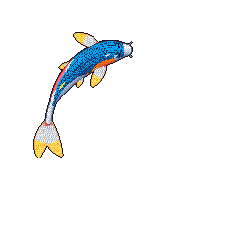

Hi, I'm Diego Hernandez. I build practical tools with Rust, TypeScript, and machine learning, contribute to open source, and write about what I learn along the way.

[Portfolio & blog](https://diegohh.net) · [LinkedIn](https://www.linkedin.com/in/diegohh0411)

My [koi](https://github.com/yalongwastaken/git-koi) starts with a white body. Its patches reflect the languages in my public GitHub activity, mapping GitHub's language colors to red, orange, yellow, blue, or black pigments. Gold fin accents reflect recent contribution streaks, while my longest streak shapes the colors' vibrancy and sparkle.
